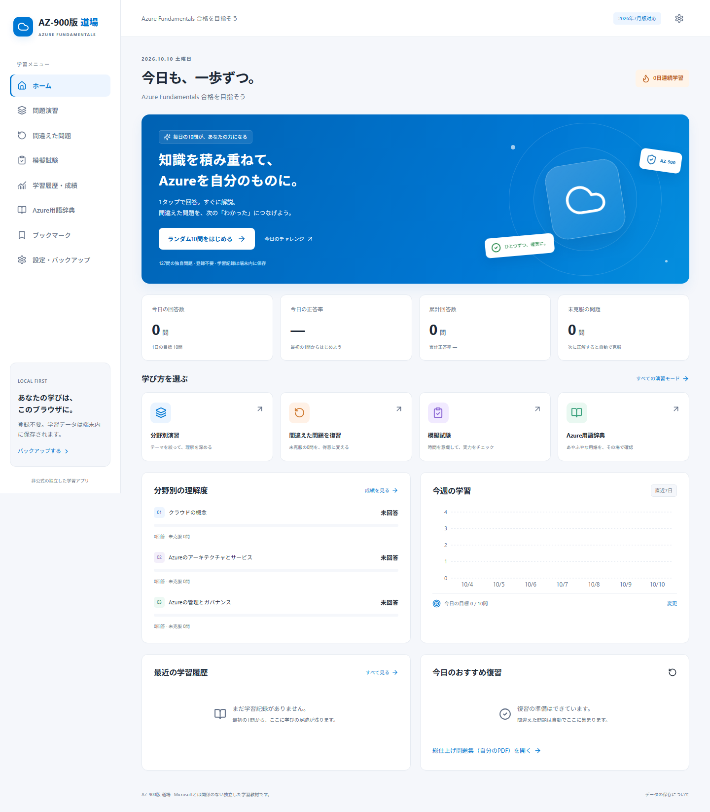

# AZ-900版 道場

**1タップで答える。すぐに理解する。間違えた問題を、得意に変える。**

Microsoft Azure Fundamentals（AZ-900）を学ぶための、日本語の完全静的Webアプリです。GitHub Pagesだけで動作し、登録・ログイン・サーバー・外部データベースは不要です。学習記録は利用者のブラウザ内のIndexedDBに保存します。

独自問題 **127問**、独自日本語用語辞典 **156語**。2026-10-10に[Microsoft公式学習ガイド](https://learn.microsoft.com/ja-jp/credentials/certifications/resources/study-guides/az-900)を確認し、**2026年7月20日版**を基準にしています。Microsoftの公式製品ではありません。実際の試験問題・流出問題は収録していません。

**公開アプリ → [https://kosukechun.github.io/az900/](https://kosukechun.github.io/az900/)**

2026-10-10に公開しました。現在の検証は単体・UI・DB34件、実ブラウザ24件の計58件です。公開URLで演習、375px表示、オフラインでの回答復元も確認しています。[公開・検証のActions](https://github.com/kosukechun/az900/actions/workflows/pages.yml)

操作改善として「次の問題へ」を正誤の判定の近くへ移し、分野・テーマの複数選択に対応しました。127問を公式本文で再確認し、正答を維持したまま14問の条件・解説を改善しました。[全問の再確認記録](docs/question-review-2026-10-10.md)

変更後の画面例：[PCの判定と次ボタン](docs/screenshots/practice-result-desktop.png) / [スマートフォンの判定と次ボタン](docs/screenshots/practice-result-mobile.png) / [複数選択の演習設定](docs/screenshots/practice-filters-mobile.png)



スマートフォンの画面例は[こちら](docs/screenshots/home-mobile.png)。

## すぐに起動する

推奨環境は **Node.js 22.12以上（22系）、npm、Chrome/Edge/Firefox/Safariの現行版**です。以下はWindows PowerShellで実行できます。`PS C:\...>` は入力せず、コマンドだけを1行ずつ実行してください。

```powershell
cd C:\Users\kosuk\script\az900
npm ci
npm run dev
```

ブラウザで **http://127.0.0.1:5173/az900/** を開きます。停止はターミナルで `Ctrl+C`。

この作業環境にはシステムNode.js 20.12が入っていました。Node 22を開発依存として同梱し、`npm run` はプロジェクト内のNode 22を使用します。古いシステムNodeで `Cannot find native binding` が出る場合は、次で任意依存を追加してから再実行してください。

```powershell
.\scripts\npm-modern.ps1 install --include=optional
npm run dev
```

新しい環境ではシステム自体をNode 22.12以上に更新することを推奨します。`file://` でHTMLを直接開く方式には対応していません。

### 本番ビルドを手元で確認する

```powershell
npm run build
npm run preview
```

**http://127.0.0.1:4173/az900/** を開きます。PWA・オフラインの検証は、この本番ビルドで行います。開発サーバーではService Workerを有効にしていません。

## 実装した機能

| 画面 | 内容 |
| --- | --- |
| ホーム | 今日・累計の回答数と正答率、未克服数、連続学習、目標、前回の続き、最近の履歴、分野別成績、7日推移、おすすめ復習 |
| 問題演習 | 単一選択は1タップで確定・即時解説。選択肢ごとの理由、覚えるポイント、公式参照、関連語。二重保存防止 |
| 分野別演習 | 分野・テーマの複数選択、5/10/20/30/50/全問題、対象不足の案内。問題一覧からの個別演習 |
| 出題モード | ランダム、未回答、過去に一度でも不正解、現在未克服、ブックマーク、苦手分野、日替わり10問 |
| 復習 | 最新回答が不正解の問題を自動登録。次に正解すると自動解除。過去の不正解履歴は保持 |
| 模擬試験 | 5〜50問、分野比率変更、5〜90分、カウントダウン、前後移動、回答状況、見直しマーク、一時停止・復元、終了時採点、全問解説 |
| 成績 | 回答数、正誤数、正答率、初回・直近50問、未克服・克服済み、学習時間、連続日数、6種類の分析、回答・間違い履歴 |
| Azure用語辞典 | 日本語・英語・略称・部分一致・分野検索、お気に入り、関連語、5種類の比較表。演習からモーダルで開いて戻れる |
| ブックマーク | 問題の登録・解除・一覧・専用演習 |
| 設定・バックアップ | ライト/ダーク/システム、問題数、目標、自動遷移（初期OFF）、JSON出力、形式検証、統合・置換復元 |
| 自分のPDF | 総仕上げPDFの端末内保存、読書、再開ページ、40問の学習チェック |
| PWA | ホーム画面追加、静的教材の事前キャッシュ、オフライン演習、更新通知 |

PCではサイドバー、850px以下では下部固定ナビゲーションを使用します。320/375/430/768/1024/1440pxをブラウザテストで確認します。正誤は色と文字・アイコンで示し、キーボードのフォーカスとダイアログにも対応しています。

### 演習の操作

1. ホームの「ランダム10問をはじめる」、または演習条件を選んで開始。
2. 選択肢をタップするだけで回答確定・解説表示。回答済みの選択肢は変更できません。
3. 正解・不正解の判定の近くにある「次の問題へ」、または `Enter` で進む。PCでは判定の横、スマートフォンでは直下に表示します。`1`〜`4` でA〜Dを選択できます。
4. 複数選択問題のみ、必要な選択肢を選んで「回答を確定」。

画面上の判定はネットワークやDB保存を待ちません。保存中は次への操作を待機し、失敗した場合は「保存を再試行」で同じ回答を保存できます。保存済みを確認してからブラウザを閉じてください。

演習設定の分野・テーマは、チェックボックスで複数選べます。選んだ分野のいずれかに属し、選んだテーマのいずれかに一致する問題をまとめて出題します。「すべての分野」「すべてのテーマ」でその条件を解除できます。分野を変更して対象から外れたテーマだけを自動解除します。

### 復習の仕組み

`answerAttempts` は追記型の履歴、`questionProgress` は現在の状態です。

| 回答順 | 結果 | 現在の未克服 | 残る履歴 |
| --- | --- | --- | ---: |
| 1 | 不正解 | 登録 | 1件 |
| 2 | 正解 | 解除 | 2件 |
| 3 | 不正解 | 再登録 | 3件 |
| 4 | 正解 | 解除 | 4件 |

「過去に間違えた問題」には4回目のあとも残ります。未克服演習は誤答回数が多い問題・直近で間違えた問題を優先します。同一セッションに同じ問題は入りません。

### 模擬試験について

試験中は解説・正解を表示しません。回答は変更できます。「試験終了」または時間切れで採点し、未回答は不正解の回答イベントとして記録します。未回答数は結果画面で誤答数と分けて表示します。

一時停止してから閉じれば残り時間を保持します。一時停止せずに閉じた場合、実時間の締切は進みます。再開時に締切を過ぎていれば自動採点します。結果画面の再読み込みで回答履歴を追加しません。

**アプリの正答率はMicrosoftの公式スコアではありません。** 合否や公式点数の推定はしません。

## 総仕上げ問題集（追加PDF）

提供ファイル `C:\Users\kosuk\Downloads\mogimondai.pdf` はインプレス刊『徹底攻略 Microsoft Azure Fundamentals教科書［AZ-900］対応 第2版』の総仕上げ資料です。**40問・60分・32ページ**。問題は2〜16ページ、解答は17〜32ページです。

ホームまたは設定から「総仕上げ問題集」を開き、**ご自身のPDFをファイル選択**してください。初回選択後は端末内IndexedDBにファイルを保持します。再開ページと理解できた問題のチェックも保存します。PDFが埋め込み表示できないモバイルブラウザでは「別タブで読む」を使用してください。

このPDFは公開転載許諾が確認できない購読者向け教材なので、GitHubや公開JSONには含めていません。PDFファイルと学習チェックはJSONバックアップの対象外で、通常演習の正答率・未克服リストとは別です。PDFの40問を自動採点する機能は未実装です。端末移行時は元のPDFを再度選択してください。

2024年の教材と最新の試験範囲・サービスの差は [PDF確認記録](docs/pdf-review.md) にまとめています。例としてEntraロールとAzure RBACの区別、監視ツールの対象、AVDの対応OSの更新があります。PDFの指示はアプリ開発指示として扱っていません。

## データの保存・バックアップ

データはブラウザ内に保存され、サーバーへ送信されません。端末、ブラウザ、オリジン（URLのドメイン・ポート）が変われば自動共有されません。ブラウザのサイトデータ削除、シークレットモード、故障で失われることがあるため、定期的にバックアップしてください。

### 書き出し

設定 → **「学習データをバックアップ」** → `az900-dojo-backup-YYYY-MM-DD.json` をダウンロード。

対象は回答履歴、各問題の進捗、演習・模試セッション、問題ブックマーク、辞典お気に入り、設定、学習目標です。形式バージョンと作成日時も含みます。個人の学習記録なので不用意に第三者へ共有しないでください。

### 復元・端末移行

1. PCなどでJSONをバックアップする。
2. 自分のスマートフォンなどへファイルを送る。
3. 同じサイトの設定 → **「学習データを復元」** でJSONを選ぶ。
4. 件数を確認し、復元方式を選んで実行する。

**統合**は回答イベントIDで重複排除し、履歴全体から現在の復習状態を再計算します。正答数を単純加算しません。同じイベントIDに異なる内容がある場合は、トランザクションを取り消して既存データを保持します。

**置換**は確認ダイアログのあと、学習記録の7ストアを置き換えます。PDFストアは保持します。復元前に現在のデータをバックアップしてください。

Zodで形式・バージョン・ID・型・値域をチェックします。100MBを超えるファイルは受け付けません。問題バンクは別の静的教材なので、バックアップで変更されません。

## GitHub Pagesへ公開する

現在のリモートは **https://github.com/kosukechun/az900.git** です。**https://kosukechun.github.io/az900/** へ公開済みで、初回のPages設定も完了しています。次回は `main` にpushすると自動検証・公開されます。以下の初回設定は別のリポジトリに移す場合の手順です。

### 初回設定（GitHubの画面で1回だけ）

1. リポジトリを開き **Settings → Pages**。
2. **Build and deployment → Source** を **GitHub Actions** に変更。
3. Settings → Actions → GeneralでActionsが有効であることを確認。
4. 無料の公開Pagesを利用する場合は公開リポジトリを使用。非公開リポジトリはGitHubの契約によってPages利用条件が異なります。

### アプリを送る

```powershell
git add .
git commit -m "Build AZ-900 dojo static learning app"
git push -u origin main
```

各コマンドを別々に実行します。`origin` は登録済みなら追加不要です。今のブランチ名は `git branch` で確認できます。GitHub認証が求められた場合はGit Credential Managerのブラウザ認証を使い、パスワードやトークンをアプリのコードに書かないでください。

### 自動デプロイ

[.github/workflows/pages.yml](.github/workflows/pages.yml) が以下を実行します。

1. Node 22・`npm ci`
2. Vitest
3. 教材検証・TypeScriptチェック・本番ビルド
4. Chromium導入・Playwright
5. `dist/` をPagesアーティファクトとして公開

`main` push、手動 `workflow_dispatch` でデプロイし、Pull Requestでは検証のみです。ビルドジョブは `contents: read`、デプロイジョブは `pages: write` と `id-token: write` を使用します。GitHub Actions画面で緑色の完了を確認し、公開URLを開いてください。初回は反映まで数分かかる場合があります。

### リポジトリ名を変える場合

Actionsは `GITHUB_REPOSITORY` からパスを計算するため、`az900-dojo` などに変更しても設定コードを編集せずビルドできます。`USERNAME.github.io` リポジトリでは `/` になります。

ローカルは既定 `/az900/` です。別のパスで確認する場合：

```powershell
$env:VITE_BASE_PATH = "/az900-dojo/"
npm run build
npm run preview
```

対応URLは `http://127.0.0.1:4173/az900-dojo/`。環境変数は前後 `/` を付けてください。解除は `Remove-Item Env:VITE_BASE_PATH`。

`HashRouter` なので `/#/review` の直接アクセス・再読み込みもPagesで404になりません。静的JSONの取得、JS/CSS、PWAの `scope`・`start_url` は同じbaseを使用します。`manifest.webmanifest` とService Workerはビルド時に生成されます。[Vite公式Pages手順](https://vite.dev/guide/static-deploy.html#github-pages)も参照してください。

## PWA・更新・オフライン

初回オンラインアクセスで画面・JSON教材を事前キャッシュします。インストールはChrome/Edgeのメニュー、iOS Safariの共有 → ホーム画面に追加から行えます。インストール可能性やPDF埋め込みは端末・ブラウザに依存します。

新バージョンは画面上部の通知で「更新する」を押すと反映します。保存済みを確認してから更新してください。古い静的キャッシュはWorkboxが整理し、IndexedDBは更新時に消しません。公開先のURLを変更する際は、先にバックアップしてください。

Microsoft Learnなどの外部リンクはオフラインでは閲覧できません。個人PDFも、その端末で選択・保存済みのファイルだけを開けます。

## 問題・用語の追加

教材は静的JSONです。アプリ本体のコード変更は不要です。

```text
public/data/
  question-files.json           # 読み込む問題ファイル一覧
  categories.json               # 分野・中分類・標準出題比率
  questions/
    cloud-concepts.json          # 34問
    azure-services.json          # 53問
    management-governance.json   # 40問
  glossary.json                 # 156語
```

### 問題スキーマ

```json
{
  "id": "QNEW001",
  "version": 1,
  "domain": "cloud",
  "subcategory": "クラウドサービスモデル",
  "difficulty": "basic",
  "questionType": "single",
  "questionText": "独自に作成した問題文",
  "options": [{"id":"A","text":"選択肢1"},{"id":"B","text":"選択肢2"}],
  "correctOptionIds": ["A"],
  "explanation": "正しい理由を説明",
  "optionExplanations": {"A":"正しい理由","B":"違う理由"},
  "keyPoint": "覚えるポイント",
  "relatedTermIds": ["iaas"],
  "referenceUrls": ["https://learn.microsoft.com/ja-jp/azure/security/fundamentals/shared-responsibility"],
  "originType": "original",
  "license": "CC-BY-4.0",
  "lastVerifiedAt": "2026-10-10"
}
```

`domain` は `cloud` / `services` / `management`。選択肢は2〜4個。複数選択は `questionType: "multiple"` と正答IDを2つ以上にします。日本語の中分類名は `categories.json` と揃えます。

新規問題を配列JSONにして、次で追加します。

```powershell
npm run import:questions -- .\new-questions.json extra.json
npm run validate:data
npm test
npm run build
```

インポートは重複などを検証してからJSONを作り、`question-files.json` にも追記します。既存ファイルの上書きは拒否します。

CSVにも対応します。1行目は上記フィールド名を使用し、`options` / `correctOptionIds` / `optionExplanations` / `relatedTermIds` / `referenceUrls` のセルはJSON文字列で記述します。CSVの引用符はRFC形式で二重化してください。コマンドは同じで入力ファイルを `.csv` にします。

問題更新では安定したIDを保持し、`version` を上げます。途中のセッションに旧バージョンが含まれる場合、誤った採点を避けて新しい演習への案内を表示します。回答イベントには回答時のバージョンが残ります。過去バージョンの問題本文スナップショット保持は現状未実装です。

用語を追加する際は `glossary.json` の既存項目を参考にID・和英名・略称・分類・一言説明・詳細・使用例・要点・関連語・公式URL・確認日を記載します。試験範囲の直接の項目でない補足語は `examScope: "supplementary"` とし、UIに「補足」を表示します。

検証はID・問題文の重複、正答と選択肢の整合性、解説、関連語ID、公式HTTPS URL、ライセンス、確認日をチェックします。**形式検証は正答の事実性や転載権を保証しません。** 追加時は公式資料との照合・ライセンス確認も必要です。

`scripts/author-question-bank.py` は初期問題の編集元です。既存JSONに初期定義より新しいversionがある場合は、その改訂を保持します。ただし元の3ファイルを再生成するため、通常の問題追加はインポートまたは直接JSON編集を使ってください。

## 教材の出典・ライセンス

提供された `AZ900_sources_2026-10-10.md` / `.json` を確認しています。そこに掲載された第三者問題本文は転載していません。無料公開と再配布許可は区別し、公式説明を根拠に独自の日本語問題・用語説明を書いています。

- [問題データの確認・出典記録](docs/content-audit.md)
- [127問の再確認と改善記録](docs/question-review-2026-10-10.md)
- [辞典の確認・出典記録](docs/glossary-audit.md)
- [追加PDFの確認記録](docs/pdf-review.md)
- [設計・保存・バックアップの詳細](docs/architecture.md)

ソフトウェアは [MIT](LICENSE)。新規作成した問題・解説・辞典データは **CC BY 4.0** です。再利用時は「AZ-900版 道場」、このリポジトリへのリンク、[CC BY 4.0](https://creativecommons.org/licenses/by/4.0/)へのリンク、変更した場合の変更表示を付けてください。Microsoft文書や出版社PDFなど、リンク先の第三者資料にこのライセンスは適用されません。

## テスト

```powershell
npm run validate:data
npm test
npm run build
npm exec -- playwright install chromium
npm run test:e2e
```

Vitest + React Testing Library + fake-indexeddbでは、正誤判定、解説、二重クリック、複数選択、模試の途中非表示、出題条件、指定件数、復習状態4段階、トランザクション、DB再開、旧スキーマ移行、バックアップ検証・統合・置換・重複排除・衝突時ロールバックを検証します。

Playwrightは本番ビルドを起動し、主要学習フロー、実ファイルのバックアップ、ブラウザプロセスの終了・再起動、PWAオフライン、PDF保存、6画面幅の横幅を確認します。ブラウザテストはChromiumで、Safari/iOS実機の動作は別途確認が必要です。結果は [docs/test-results.md](docs/test-results.md) に記録します。

## 技術と構成

React 18 / TypeScript / Vite 8 / Tailwind CSS 4 / React Router 7（HashRouter）/ Dexie.js / IndexedDB / Recharts 3 / Lucide React / Zod / vite-plugin-pwa / Vitest 5 / React Testing Library / Playwright / GitHub Actions / GitHub Pages。

```text
src/
  components/        # 選択肢・解説・辞典モーダル・グラフ
  pages/             # ホーム・演習・復習・模試・成績・辞典・設定・PDF
  layouts/           # PCサイドバー・モバイルナビ・テーマ・PWA更新
  hooks/             # IndexedDBのライブ参照
  db/                # スキーマ・移行
  services/          # 回答保存・模試採点・バックアップ・静的JSONロード
  types/ utils/ styles/ tests/
public/data/         # 公開する独自教材
public/icons/        # 独自の雲とチェックのアイコン
scripts/             # 検証・JSON/CSV追加・Windows Node補助
e2e/                 # 実ブラウザテスト
docs/                # 設計・出典・PDF・検証記録
.github/workflows/   # 検証とPages公開
```

学習DBはv2です。v1からの移行は自動で、自動遷移秒数を補完し、PDFストアを追加します。回答保存・進捗更新・セッション更新は1つのトランザクションです。回答イベントIDは `セッションID:問題ID` で、二重クリックと再採点による追加を防止します。正答は静的JSONに含まれ、開発者ツールから確認できることを許容しています。

## 現在の制限・今後の改善

- PDFの自動採点・公開問題への変換は未実装。転載許諾と問題ごとの精査が必要です。
- 自動端末同期はありません。JSON移行を利用します。
- 現行版は教材を起動時に読み込みます。数千問に増える場合は問題索引と分割遅延ロードを追加できます。
- 過去バージョンの問題本文保持、より細かい中分類の苦手分析、間隔反復による復習日程が改善候補です。
- 間違い一覧からの追加練習は同じ大分類です。同じ中分類への直接セット出題は改善候補です。
- 画面のラベル・キーボード・色以外の判定は対応済みですが、スクリーンリーダー実機での包括的監査、iOS/Safari実機検証は未実施です。
- 学習時間は回答所要時間の合計、模試結果の時間は制限時間から残り時間を引いた値です。バックグラウンド読書時間は追跡しません。
- 教材の全問を第三者のAzure専門家が監修したものではありません。誤りやサービス更新は公式資料との照合を継続してください。

Supabase、Firebase、メール認証、アカウント、バックエンド、有料APIは使用していません。
